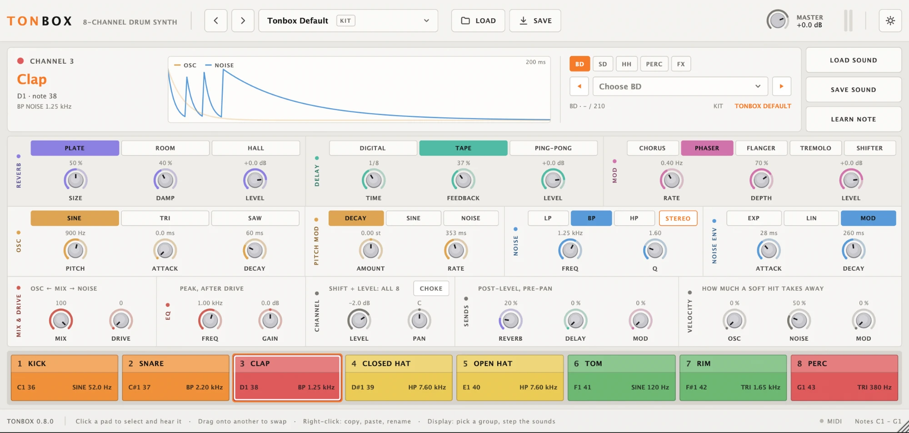
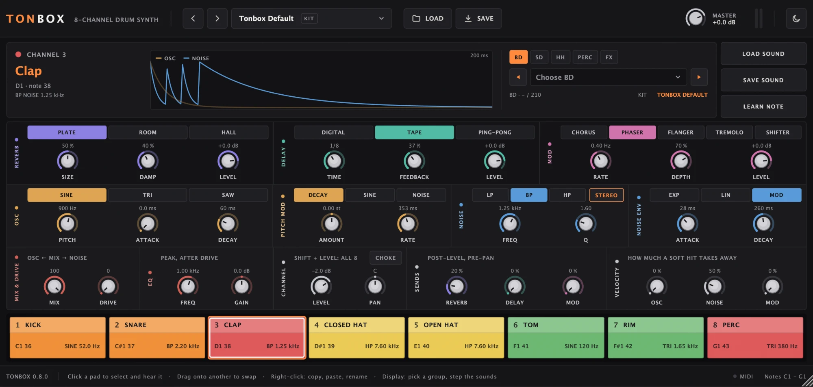

# Tonbox

An eight-channel drum synth for macOS: AU (aumu/Tnbx/Tzor), VST3 and a standalone app, built with JUCE 9. Every channel is the same small synthesiser:
- an oscillator (sine, triangle or saw) with a pitch modulator,
- a filtered noise source with its own envelope,
- a mix of the two, followed by distortion, a peaking EQ, level and pan.

Each channel also has three sends into FMBox's effects: reverb, delay (tempo-synced) and modulation. Click a pad at the bottom to hear the channel, then edit it above.

Family: [Kitbox](https://github.com/TZorr/Kitbox), [FMBox](https://github.com/TZorr/FMBox), [Rackbox](https://github.com/TZorr/Rackbox), [Rackbox Plus](https://github.com/TZorr/RackboxPlus), [Chordbox](https://github.com/TZorr/Chordbox), [Transmute](https://github.com/TZorr/Transmute).





## Channels

| Section   | Controls |
|-----------|----------|
| Osc       | Sine / Tri / Saw, Pitch (20 Hz – 20 kHz), Attack, Decay (time to −60 dB) |
| Pitch Mod | Decay / Sine / Noise, Amount (±96 semitones), Rate (ms in Decay mode, Hz otherwise) |
| Noise     | LP / BP / HP, Freq, Q (0.1 – 10000), Stereo |
| Noise Env | Exp / Lin / Mod (Mod repeats the attack as clap bursts), Attack, Decay |
| Mix & Dist | Osc ↔ noise mix, asymmetric distortion |
| EQ        | Peaking, after the distortion: broad boost, narrow cut |
| Channel   | Level, Pan, Choke (choked channels cut each other off); Shift + Level moves all eight levels by the same dB |
| Sends     | Reverb, Delay and Mod, post-level and pre-pan |
| Velocity  | How much a soft hit lowers osc, noise and modulation (0 – 200 %) |

The three send effects come from FMBox, which has them from Kitbox and Rackbox:
- **Reverb:** Plate, Room or Hall.
- **Delay:** Digital, Tape or Ping-Pong. It always follows the host tempo.
- **Mod:** Chorus, Phaser, Flanger, Tremolo or Shifter.

Each effect has a Type, two knobs and a return level.

- **Pads:** each pad shows the sound's name. Drag a pad onto another to swap the two sounds, including their names and sends; the notes stay with the pad's position. Right-click a pad to copy its sound, paste a copied one (also between Tonbox instances) or rename it.
- **Kit name:** shown at the bottom right of the display. Click it to rename. The names are saved with the session and in presets.
- **Notes:** channels 1–8 are on C1–G1 (36–43). Learn reassigns them: pick a pad, press LEARN NOTE and play a key. A note that is already taken swaps channels.
- **Shift + Level:** drag the Level knob with Shift held and every channel's level moves by the same number of dB, so the kit's balance stays. It counts from the levels at the start of the drag: a channel that hits −60 or +10 dB stops there, and dragging back restores it. A channel that is off (−60 dB) stays off. For the whole output alone, Master is enough.
- **Default kit:** kick, snare, clap, closed hat, open hat (the two hats choke each other), tom, rim and a percussion sound.
- **Knobs:** each shows its name; the value takes its place while the mouse is over the knob or turns it, and for a second after, as in Logic's own plug-ins. Automation leaves the names standing.
- **Dark:** the button under the wordmark switches to the dark panel. The setting belongs to you, not to the session.

## Presets

**PRESETS** beside the Dark switch opens the plugin's own preset menu. It lists `~/Library/Audio/Presets/T'Zorr/Tonbox/`, and each subfolder becomes a submenu. It also has Save Preset…, Load Preset… and Show in Finder. Presets are `.tonbox` files: plain XML that names the plugin and holds its settings, readable in any text editor. Logic keeps its own `.aupreset` settings in its own menu; the two do not mix. In VST3 hosts such as Bitwig this menu is the only way to load and save presets. A preset is a kit: Save suggests the kit name, and the kit takes the name it is saved under.

## Sounds

Single sounds load onto the selected pad. The right half of the display browses the sound library, `~/Library/Audio/Presets/T'Zorr/Tonbox/Sounds/`, one folder per group:

- **BD SD HH PERC FX** (and any folder of your own) pick the group to browse. A group button loads nothing.
- **◀ ▶** load the previous or next sound of the group onto the pad. Nothing plays; the pad or a key does that.
- **The name** opens the group's whole list. Groups of more than 40 sounds are split into submenus by name prefix: the first word, up to a hyphen, so all of a family's sounds share one submenu.
- Below, the group, the place in it (`BD · 12 / 210`) and the kit name.

A loaded sound sets the pad's sound knobs and name. The pad's note stays, and so does anything the file doesn't hold, such as the sends. The pad remembers the file, so ◀ ▶ carry on from there, also after the session is reopened.

**LOAD SOUND** and **SAVE SOUND**, beside the display, open the browsed group's folder. Sounds are `.tonboxsound` files: the same plain XML a copied pad puts on the clipboard.

## Build

```bash
Scripts/build.sh
```

The script builds and then runs two checks: `TonboxCheck` tests the engine against the specification, and `EditorShot` tests the processor and renders the panel. Then `Scripts/install.sh` copies the plugins into `/Library/Audio/Plug-Ins` (through sudo, so it asks for an admin password) and runs auval.

This needs JUCE at `~/JUCE` and CMake/Ninja (see `Scripts/build.sh`).

## License

AGPL-3.0, see LICENSE.
